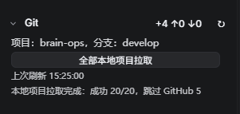

# openchamber-git-commit

Git 状态区，给 OpenChamber 用的紧凑状态行。全走 git 原生命令，中文界面。

Git status strip for OpenChamber: sync, pull-all across sibling repos, ahead/behind at a glance. Chinese interface, all operations run native `git` commands.



## 功能

- 标题栏 `+改动数 ↑超前 ↓落后`（只读，点开自带 git 面板）与 `↻`（刷新同步）；老宿主不支持标题栏控件时退回区内「刷新同步」按钮
- 内容区第一行 `项目：xxx，分支：yyy`，点开自带 git 面板
- 内容区第二行「全部本地项目拉取」+ 未推送条数角标，下一行 `上次刷新 HH:MM:SS`
- 「全部本地项目拉取」：后台逐个 `git pull` 上层目录下的 git 项目，**远端指向 github.com（含 SSH 地址）的仓自动跳过**，2 秒轮询进度，结果行汇总成功 / 跳过 GitHub / 冲突 / 失败
- `↻` 刷新同步：一键 `fetch → 拉取 → 推送`，落后或分叉时拦下并给中文提示
- 1 分钟自动刷新，切回页面时立即刷新

`↑N` = 本地领先远程 N 个提交（待推），`↓N` = 远程比本地多 N 个提交（待拉）。

## 接口

状态区只调这 4 个 service 接口：

| 方法 | 路径 | 字段 | 说明 |
| --- | --- | --- | --- |
| GET | `/status?dir=` | dir: 仓库目录（绝对路径） | 当前分支、超前落后、改动文件数 |
| POST | `/sync` | { dir } | fetch → ff-only 拉取 → 有超前就推送 |
| POST | `/pull-all` | { dir } | 以当前仓库的上层目录为范围，后台逐个 pull，返回 jobId |
| GET | `/pull-all-status?jobId=` | jobId | 轮询全部拉取进度 |

一行示例：`POST /sync {"dir":"/home/liaoz/code/brain-ops"}` → `{"ok":true,"pulled":2,"pushed":0}`。

用法要点：

- `/status` 只做 `status --porcelain=v1 -b`，不查 log，1 分钟轮询一次也够轻
- `/sync` 分叉（本地有超前、远端有落后）时不合并，直接报 `diverged` 让用户手动处理
- `/pull-all` 跳过 GitHub 仓（只看远端主机名，不联网），结果行按成功 / 跳过 / 冲突 / 失败汇总

## 安装

OpenChamber → 设置 → 扩展 → 粘贴 Git 地址添加：

```text
https://github.com/xcvsfsd/openchamber-git-commit
```

批准 `service(git)` + `model` 能力，状态区即出现 Git 行。

本地开发可用文件夹路径安装（改完 `bun run build` 即生效）。

## 说明

- `openchamber.contributes.panel` 必须保留 `id`/`name`/`icon`，即使扩展只有状态区、没有面板页（`panel.entry` 可省略）。整块删掉会让宿主解析 manifest 失败（`missing-panel`），重启后扩展直接从列表消失——而内存里旧版本还活着，所以改完不重启看不出来。
- 只在打开项目（git 仓库）时工作，非 git 项目显示一句提示。
- service 跑用户全权限，只执行 `git`，参数全校验（dir），不用 shell。
- 手机 App / VS Code 不加载扩展（Web 和桌面版可用）。
- 发版：改完 `bun run build`，升 `package.json` version，提交 built 文件（`status/main.js`、`service/main.js` 必须提交）。

## License

MIT
